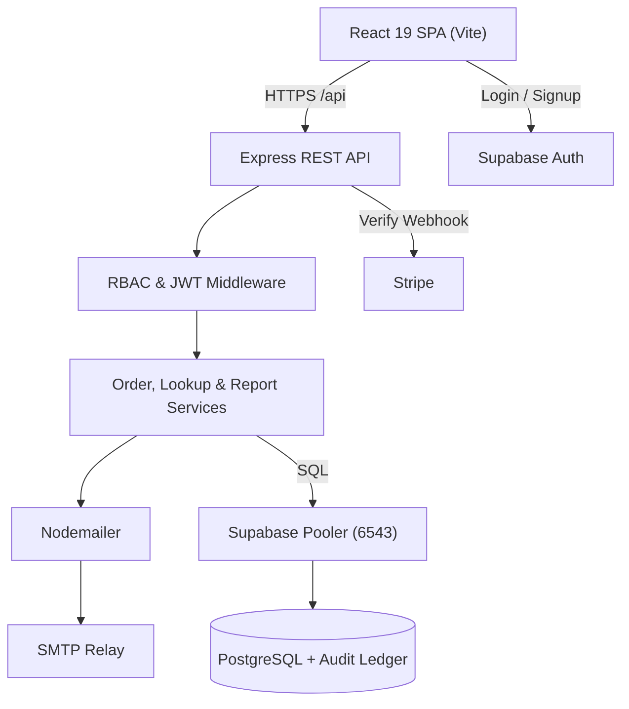

# Milky Shakes Drinks

[](#testing--quality-assurance)
[](https://nodejs.org/)
[](https://react.dev/)
[](https://vitejs.dev/)
[](https://expressjs.com/)
[](https://supabase.com/)
[](#)

---

**Welcome, TOPPAN recruitment team, and thank you for the opportunity to share this project with you.** I hope you have as much fun going through it as I did building it :)

---

## Overview

Milky Shakes Drinks custom milkshake ordering, payment, and live kitchen operations for two user groups:

1. **Patrons** build bespoke milkshakes (1-10 drinks per order), choose Store Pickup or Home Delivery, pay via Stripe or a simulated checkout, and receive a traceable receipt.
2. **Managers and kitchen staff** use a management portal with sub-500ms query latency, live order status tracking, inventory controls, pricing administration, and audit logging.
## Key Features

**Ordering**
- Customizable flavour, consistency, and toppings per drink
- Dynamic pricing with price snapshots, so historical orders never change when menu prices do
- Automatic breakdown of subtotal, 15% VAT, R15.00 delivery fee, and loyalty discounts
- Pickup or delivery with address and phone validation
- Numbered receipts (`RCP-YYYYMMDD-XXXX`), printable and emailed via Nodemailer
- Order history with loyalty tier progression

**Management and Kitchen**
- Metrics dashboard: revenue, order volume, average order value, fulfillment split, top ingredients
- Multi-criteria order filtering
- Status pipeline: `PENDING_PAYMENT` → `PAID` → `PREPARING` → `READY` → `COLLECTED` / `CANCELLED`
- Admin editing of flavours, toppings, consistencies, and discount tiers without code changes
- Inventory toggles and store open/close control

**Security and Compliance**
- Role-based access control for `PATRON`, `STAFF`, and `MANAGER`
- Immutable audit trail recording who changed what, when, and from where
- Response sanitization so secrets and password hashes never reach the client

## Architecture

The platform pairs **Vercel** (edge hosting and serverless functions) with **Supabase** (PostgreSQL and managed authentication).




## Technology Stack

| Layer | Technology |
| :--- | :--- |
| Monorepo | npm Workspaces |
| Frontend | React 19, Vite |
| Backend | Node.js 20+, Express |
| Database | Supabase PostgreSQL 15+ |
| Auth | Supabase Auth / JWT |
| Payments | Stripe with signed webhooks |
| Email | Nodemailer |
| Validation | Shared JS and Zod |
| Hosting | Vercel |

## Getting Started

**Prerequisites:** Node.js 20+, npm 10+. Supabase and Stripe accounts are optional.

```bash
git clone https://github.com/your-username/milky-shakes-drinks.git
cd milky-shakes-drinks
npm install
cp .env.example .env.local
npm run dev
```

Open [http://localhost:5173](http://localhost:5173). Vite serves the client and mounts the API on the same port, so no extra setup is needed. To run the API alone on port 3001, use `npm run dev:api`.

**Key environment variables:** `PORT`, `DATABASE_URL`, `VITE_SUPABASE_URL`, `VITE_SUPABASE_ANON_KEY`, `SUPABASE_SERVICE_ROLE_KEY`, `STRIPE_SECRET_KEY`, `STRIPE_WEBHOOK_SECRET`, and optional `SMTP_*` settings.

## API Overview

All endpoints are prefixed with `/api`.

**Public and patron:** `/health`, `/login`, `/signup`, `/lookups`, `/orders/calculate`, `/orders`, `/payments/checkout-session`, `/payments/simulate`, `/webhooks/payment`, `/orders/:orderId/receipt`, `/orders/email-receipt`, `/patron/orders`

**Management (STAFF / MANAGER only):** `/admin/reports/summary`, `/admin/reports/orders`, `/admin/reports/audit-logs`, `/admin/reports/export`, `/admin/orders/:orderId/status`, `/admin/inventory`, `/admin/store-status`, `/admin/lookups/:type`, `/admin/configurations/:key`

## Testing

```bash
npm test        # 48 tests using Node's native test runner
npm run build   # Verify production build
```

Tests cover price calculation, order validation, payment idempotency, RBAC enforcement, audit trails, CSV export, data sanitization, and the sub-500ms filtering SLA.

## Deployment

Configured for Vercel via `vercel.json`. Static assets are served from `packages/client/dist`, `/api/*` routes to serverless functions, and all other paths fall back to `index.html`.

```bash
npm install -g vercel
vercel
```

Set the environment variables above in your Vercel project settings.

## Documentation

See the `docs/` folder for the architecture decision record, technology stack, assumptions and constraints, stakeholder analysis, and risk register.

---

Thank you again to the TOPPAN recruitment team for your time and consideration. I would welcome the chance to walk you through any part of this project.
